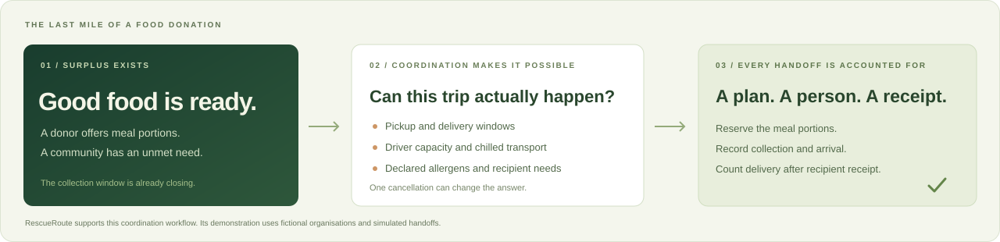
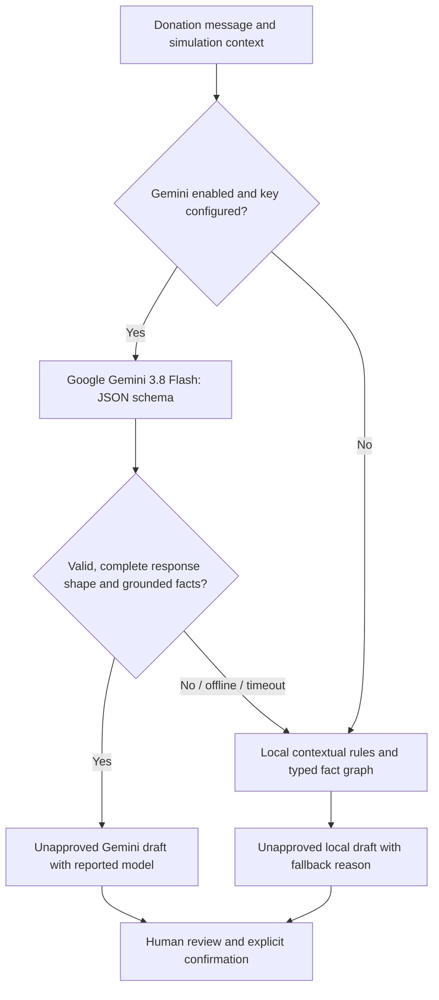

# RescueRoute — Every meal has somewhere to go.

<p align="center">
  
</p>

<p align="center">
  
</p>

<p align="center">
  <a href="#why-this-problem-matters"><strong>The problem</strong></a> ·
  <a href="#start-the-demo"><strong>Get started</strong></a> ·
  <a href="#working-panels">Explore the features</a> ·
  <a href="docs/DEMO.md">Demo walkthrough</a> ·
  <a href="docs/LIVE_MAP.md">Live map &amp; GPS</a> ·
  <a href="#test-and-check">Run the tests</a>
</p>

**RescueRoute connects good food with the people who can use it.** It brings donors, community recipients, volunteers, and coordinators into one workspace—from a surplus-food message to a checked delivery plan and a recorded recipient receipt.

**Context matters.** Collection deadlines, declared allergens, chilled transport, vehicle capacity, and cancellations all shape the next decision. Offers, reservations, and received meals stay separate, so the dashboard shows what has actually happened in the demo.

**Vertical:** sustainability and community logistics. **Primary persona:** a coordinator connecting food donors, community recipients, and volunteer drivers.

## Why this problem matters

**Food can be available, and a delivery can still fail.** Someone must identify a suitable recipient, find an available driver, check handling requirements, and complete the handoff before the collection window closes. When one detail changes, the coordinator needs to know which parts of the plan still work.

UNEP’s **Food Waste Index Report 2024** estimates **1.05 billion tonnes of food waste in 2022** across households, food services, and retail, including inedible parts. RescueRoute focuses on a specific, actionable part of that wider problem: coordinating **donor-confirmed surplus meals** with community needs. It does not assume that all reported waste is recoverable food. [Source: UNEP](https://www.unep.org/en/news-and-stories/press-release/world-squanders-over-1-billion-meals-day-un-report)

<p align="center">
  
</p>

### The problem we are solving

> Help a food-rescue coordinator turn changing offers, recipient requirements, and volunteer availability into an explainable, feasible delivery plan—and keep a reliable record of what was actually received.

Consider offers and requests arriving through separate messages. The difficult questions are practical:

| The coordinator’s question                            | What can go wrong                                              | RescueRoute’s response                                                                    |
| ----------------------------------------------------- | -------------------------------------------------------------- | ----------------------------------------------------------------------------------------- |
| **Can we collect and deliver in time?**               | A nearby offer can still miss its pickup or use-by deadline.   | Check readiness, travel estimates, collection, handover, and delivery windows.            |
| **Is the declared food suitable for this recipient?** | The recipient excludes an ingredient the donor declared.       | Check declared allergen conflicts and require human review of the details.                |
| **Do we have the right transport?**                   | The only chilled-capable volunteer becomes unavailable.        | Exclude the vehicle, release its uncollected reservations, and explain the remaining gap. |
| **Has this food already been promised elsewhere?**    | Separate plans commit the same portions twice.                 | Reserve quantities atomically and reject stale confirmations.                             |
| **Did the food reach its destination?**               | Scheduled portions are reported as delivered before a handoff. | Keep offered, reserved, and recipient-confirmed portions separate.                        |

### Who this is for

**The coordinator is the central user.** Donors describe what is available; recipients describe what they need and exclude; volunteers provide transport capacity and availability. The coordinator reviews those declarations and approves the plan. Each participant then sees the actions relevant to their part of the handoff.

The intended benefit is a clearer next decision for a local food-rescue network: which offer can be collected, who can receive it, who can drive, and what is still missing. Actual waste reduction and community benefit would need to be measured in a real pilot.

## See the problem change the plan

The seeded scenario starts at **16:00**: three donors offer **80 meal portions**, two organisations request **80 portions**, and two volunteers have different transport capabilities. The earliest collection window closes at **16:40**. One donor’s **20 chilled portions** require a capable vehicle.

| Change in the scenario                                                        | Expected result                                                    | What it demonstrates                                        |
| ----------------------------------------------------------------------------- | ------------------------------------------------------------------ | ----------------------------------------------------------- |
| Both volunteers are available.                                                | **80 portions allocated across four trips.**                       | Scheduling respects the combined constraints.               |
| Alex, the chilled-capable volunteer, becomes unavailable before confirmation. | **60 portions allocated; 20 chilled portions remain unallocated.** | The assistant adapts and explains a concrete resource gap.  |
| The 80-portion plan is confirmed, then another draft is built.                | **Those reserved portions cannot be allocated again.**             | A second plan cannot double-book the same supply or demand. |
| A volunteer marks arrival.                                                    | **The portions remain awaiting receipt.**                          | Arrival alone does not establish delivery.                  |
| The recipient or coordinator confirms receipt.                                | **Only those received portions enter the delivered total.**        | Reported outcomes follow the handoff record.                |

**These are reproducible demonstration results, not real-world impact statistics.** The workflow is covered by the automated tests and the [cross-role demo walkthrough](docs/DEMO.md).

## Built around the whole rescue

| From a message to a plan                                                                                                                            | From a plan to a handoff                                                                                                               |
| --------------------------------------------------------------------------------------------------------------------------------------------------- | -------------------------------------------------------------------------------------------------------------------------------------- |
| **Thoughtful intake** — Extract stated facts, flag missing details, and ask for human review. Live AI is optional; the default parser needs no key. | **A portal for every role** — Admins, coordinators, donors, recipients, and volunteers see the records and actions relevant to them.   |
| **Plans that respect constraints** — Check quantities, time windows, dietary declarations, transport requirements, and driver schedules.            | **A network you can explore** — Click donors, recipients, and volunteers on a geographic map with live updates and opt-in GPS sharing. |
| **Room for real-world changes** — Rebuild around a cancellation while protecting existing reservations and food already in transit.                 | **A traceable finish** — Follow acceptance, pickup, arrival, and recipient receipt, then inspect the history or export the results.    |

> **A working demonstration, with clear boundaries.** The seeded organisations and deliveries are fictional. Map placements, demo movement, shared GPS, and received meals are labelled explicitly. Road routing, food-safety certification, and real dispatch are outside this prototype’s scope.

## Start the demo

Requires **Node.js 22.13 or newer**.

```sh
npm start
```

Open **http://localhost:3000**. No dependency installation is required to run the application: the server uses Node built-ins and the interface uses native browser APIs. On Windows, use `npm.cmd start` if PowerShell blocks `npm.ps1`.

Local mode binds to `127.0.0.1`, rejects non-local hostnames, and creates an ignored `.data/rescueroute.json` file. Run **one server process per data directory**. The server does not dispatch real deliveries or send external messages. For a public URL, use the isolated cloud-demo mode below.

### Deploy a public cloud demo

[](https://render.com/deploy?repo=https://github.com/Dayaleeswaran/rescueroute)

The included `render.yaml` configures a free Node web service, HTTPS-origin checks, secure cookies, and a health endpoint. **Each browser receives an isolated temporary workspace**, so public demo credentials do not expose another visitor's records or GPS fixes. Public mode uses the no-key parser and resets on restart or workspace expiry. Your Render account must authorise the actual deployment; no public URL is claimed until verified live. Follow [the deployment guide](docs/DEPLOYMENT.md).

### Demo accounts

Use **Use selected demo account** on the sign-in screen, then sign in. Every seeded account uses this public demonstration password:

```text
RescueDemo!2026
```

| Role          | Email                               | Access                                                     |
| ------------- | ----------------------------------- | ---------------------------------------------------------- |
| Administrator | `admin@demo.rescueroute.test`       | All operational panels, users, settings, reset             |
| Coordinator   | `coordinator@demo.rescueroute.test` | Network management, reviews, planning, deliveries, reports |
| Donor         | `donor@demo.rescueroute.test`       | The Green Table's profile, offers, relevant deliveries     |
| Donor         | `bakery@demo.rescueroute.test`      | Daily Bread Bakery                                         |
| Donor         | `roots@demo.rescueroute.test`       | Roots Kitchen                                              |
| Recipient     | `recipient@demo.rescueroute.test`   | Northside Shelter's profile, needs, receipts               |
| Recipient     | `riverside@demo.rescueroute.test`   | Riverside Centre's profile, needs, receipts                |
| Volunteer     | `volunteer@demo.rescueroute.test`   | Maya Chen's profile, availability, assigned trips          |
| Volunteer     | `alex@demo.rescueroute.test`        | Alex Morgan's profile, availability, assigned trips        |

These credentials are intentionally public for evaluation. Public hosting must use the isolated cloud-demo mode; do not expose the shared local workspace or reuse these passwords. Accounts can be created, disabled, and given replacement passwords from the admin panel. A password reset revokes that account's existing sessions. Administrators cannot disable their own account.

## Working panels

| Panel                      | Functionality                                                                                                  |
| -------------------------- | -------------------------------------------------------------------------------------------------------------- |
| Overview                   | Role-specific metrics, geographic network map, actionable links, recent notifications                          |
| Food offers                | Create, edit, withdraw, search, filter, review status, declared allergens, handling, use-by and transit limits |
| Recipient needs            | Create, edit, withdraw, search, filter, priority, exclusions, delivery deadline                                |
| Donor & recipient networks | Organisation profiles, contacts, latitude/longitude, activation/deactivation                                   |
| Volunteers                 | Profiles, capacity, vehicle, chilled capability, shifts, availability and cancellation                         |
| Review queue               | Approve or reject submissions with an optional review note                                                     |
| Rescue planner             | Build drafts, see unmet needs and explanations, confirm reservations, inspect persisted history                |
| Deliveries                 | Assignment acceptance, pickup, arrival, recipient receipt, recorded event timeline                             |
| Impact & reports           | Offered, reserved, and received quantities separately; JSON and donor CSV export                               |
| Notifications              | Persisted, role- and profile-filtered updates                                                                  |
| Activity log               | Latest 200 actions, with actor, time, and details                                                              |
| User accounts              | Admin-only account creation, account status, email/name updates, password resets                               |
| Settings                   | Admin-only network naming, forward-only simulation clock, provider status, guarded reset                       |

Permissions are enforced by the server, including record ownership and field whitelists. Hiding a navigation item is not the security boundary. Participant accounts only receive their own records and information relevant to assigned handoffs. User password hashes and provider keys never appear in API state or exports.

## Complete demonstration

1. Sign in as **admin**. In **Rescue planner**, build a draft. The initial scenario proposes **80 meals across four trips**. Read the collection times and explanations.
2. Before confirmation, open **Volunteers**, make Alex unavailable, and build a new draft. Only **60 meals** can be allocated; the chilled meals have no eligible vehicle.
3. Restore Alex, rebuild, then **Confirm & reserve meals**. Reservations now protect the stock, demand, and driver schedule.
4. Build another draft. Already reserved meals cannot be allocated again.
5. Sign out and sign in as **volunteer** (Maya). In **Deliveries**, accept the first trip, confirm pickup, then mark arrival. Trying to collect a later trip first is rejected.
6. Sign out and sign in as **riverside**. Confirm receipt of Maya's delivery. Only now are those meals counted as delivered.
7. Sign back in as admin. Inspect the received totals, activity log, and exports.
8. As a donor, create a new offer. It enters review. A coordinator can approve it and include its remaining quantity in a new plan.

Accounts in ordinary tabs share the same browser cookie. Sign out to switch roles, or use separate browser profiles for simultaneous sessions. Authenticated server-sent events update panels automatically. Tracking updates preserve the map view, and editing forms defer incoming changes. Manual Refresh remains available if the connection is interrupted.

See [docs/DEMO.md](docs/DEMO.md) for the judging script and [docs/API.md](docs/API.md) for permissions and endpoints.

## Decision logic and lifecycle

```text
Donor message → extracted draft → human review → pending offer
                                                ↓ coordinator approval
Approved supply + approved needs + available volunteers
                        ↓
Feasible draft → independent audit → coordinator confirmation
                                         ↓
                             stock and demand reserved
                                         ↓
Assigned → Accepted → Picked up → Awaiting receipt → Delivered
                                                       ↑
                                       recipient/coordinator confirms
```

### Allocation constraints

The pure planner considers only approved, donor-confirmed offers and approved needs at active organisations. It subtracts all confirmed reservations and all recipient-confirmed deliveries before planning. A new plan therefore operates on residual quantities.

Every trip checks:

- Positive remaining supply and demand; capacity limited to one driver load.
- No declared allergen conflict. Conservative equivalences cover milk/dairy, soy/soya, common nut labels, and several other synonyms. The broad nut group intentionally over-excludes. Unrecognised labels use normalised exact matching; this is not exhaustive allergen detection.
- Chilled transport when required by the donor.
- Travel from the driver's last committed delivery location, the offer's ready time, four minutes for collection, and collection completion before the donor cutoff.
- Four-minute delivery handover before the recipient deadline, donor-declared delivery use-by, and driver shift end.
- Transit plus delivery handover within the donor-declared maximum transit minutes.

Feasible trips receive a repeatable heuristic score based on soon-closing supply, recipient priority, load size, travel distance, and preserving chilled transport. Quantities and driver positions are updated after each selection. The independent audit directly rechecks constraints without calling the candidate/scoring function.

This is a **greedy heuristic, not a guarantee of global optimality**. An unmatched offer is not proof that no alternative schedule could deliver it.

### Reservation and delivery integrity

- Drafts reserve nothing. Confirmation rechecks the current network and commits the assignments atomically.
- A global revision rejects stale drafts and edits; concurrent confirmation requests cannot both reserve the same stock.
- Transactions are serialised within one server process. A failed transaction leaves both in-memory state and the committed data file unchanged.
- Reserved source records and linked organisation locations cannot be edited while the trips are active.
- Subsequent drafts account for committed driver schedules, including their last delivery position.
- Only the assigned volunteer or a coordinator can accept, collect, or mark arrival. Only the receiving organisation or a coordinator can confirm receipt.
- The next pickup cannot occur while an earlier non-cancelled trip for that driver is incomplete.
- A volunteer cancellation releases that driver's uncollected assignments. A volunteer carrying food cannot become unavailable until the handoff is completed.
- The coordinator's global release cancels all uncollected trips while preserving food in transit and completed receipts. Cancelling all dependent uncollected stops prevents new routes relying on a removed stop.
- Historical trip labels and contacts are snapshotted, while delivered quantities remain conserved even if a source profile changes later.
- Source quantities cannot be reduced below portions already delivered or reserved. Linked history cannot be deleted; use deactivation/cancellation instead.

## A guided rescue, with decisions you can inspect

Open **Start a rescue** for a role-specific checklist: capture details, review declarations, compare and build a plan, follow the handoff, and record recipient receipt. Seeded records may already satisfy some checks; evidence indicators describe workspace records, not real-world outcomes.

In **Rescue planner**, choose Alex under **What if a volunteer becomes unavailable?** and compare. On a fresh seed, allocation changes from **80 to 60 portions**, with **20 chilled portions** left and an explicit transport explanation. This is a read-only preview of future unreserved work: existing trips, stock, availability, history, and revisions stay unchanged. A network change marks the comparison stale. Re-run it before making a decision, then use the normal reviewed planning workflow to commit changes.

The preview checks role access, current revision, reservations, and both plans' independent feasibility audits. It does not promise a global optimum or cancel any existing delivery. See the [guided demonstration](docs/DEMO.md) and [coordinator validation protocol](docs/PILOT_CHECKLIST.md).

## Gemini and the no-key reasoning engine

RescueRoute turns donation messages into **reviewable drafts**, with a visible source for each supported fact. The prompt lives in [lib/intake-contract.mjs](lib/intake-contract.mjs). Unknown or conflicting facts stay blank; neither AI nor local rules can approve food, reserve stock, or dispatch a volunteer.



**No key is required.** The local engine recognises supported explicit quantities, labelled fields, known donors, collection times, and relative deadlines against the simulation clock. It builds a small deterministic fact graph with source evidence and clarification questions. It is a bounded rule system, not a general language model. Native progress feedback represents an actual pending request, not simulated token streaming.

For optional live extraction, add `GEMINI_API_KEY` to your ignored `.env`, set `GEMINI_MODEL=gemini-3.8-flash`, and restart. The server sends the submitted message, simulation clock, and extraction instructions to Google; the key stays server-side. API usage may incur charges. Public Render demos require the additional explicit setting `PUBLIC_AI_ENABLED=true` and allow at most 60 provider attempts per hour per process.

**Model availability:** the default is now `gemini-3.8-flash`, following owner approval after Google rejected 2.5 Flash for this key as unavailable to new users. [Gemini 3.8 Flash documentation](https://aistudio.google.com/docs/models/gemini-3.8-flash). Model discovery succeeded, but generation verification returned HTTP 503 (high demand). Successful live extraction remains unverified; labelled local fallback preserved the synthetic donation fields. The app displays the returned model version when generation succeeds.

The adapter uses Google's REST `generateContent`, `responseMimeType: application/json`, and `responseSchema`. Independent validation checks types, allowed fields, and supported source facts. Strict grounding can reject otherwise valid language outside the local vocabulary; the review form remains available. Failures return explicit local fallback, with an 8-second default timeout and 30-second circuit pause. See [AI architecture](docs/AI_ARCHITECTURE.md) and [prompt evaluation](docs/PROMPT_EVALUATION.md). See [the recorded provider status](docs/verification/gemini-status.json).

## Real map and live tracking

Open **Live network** to explore clickable donors, recipients, and volunteers on a real OpenStreetMap basemap. The details panel shows offers, quantities, needs, contact details, windows, and tracking status. Coordinators can run explicitly labelled demo movement; volunteers can opt in to browser GPS sharing. Demo placements, entered coordinates, shared GPS, accuracy, and stale fixes are distinguished. Network state updates through authenticated server-sent events. See [docs/LIVE_MAP.md](docs/LIVE_MAP.md) for privacy, geographic planning, setup, and device limits, and [THIRD_PARTY_NOTICES.md](THIRD_PARTY_NOTICES.md) for map licensing.

## Test and check

**Verification recorded during development: 76 passing automated tests**, including checks over **160 generated planning scenarios**. This is a local verification result, not a hosted CI-status claim. Re-run the commands below for the current checkout.

The only package dependencies are development tools for DOM integration and accessibility checks:

```sh
npm ci
npm test
npm run check
npm run evaluate
npm run benchmark
npm run load-check
npm run check:contrast
npm audit
```

Tests cover allocation constraints; 160 deterministic generated scenarios; conservation and reproducibility; double reservation; concurrent confirmation; stale drafts; ownership; review rules; transport cancellation; ordered handoffs; recipient-only receipt; account permissions; password-session revocation; guarded reset; persistent restart; rollback; request size; authentication; CSRF; origin checks; file exposure; and the interface event flows against the real HTTP server.

The jsdom tests are **DOM integration tests, not visual browser tests**. Native dialog methods are stubbed for that environment. They do not establish layout correctness, native dialog focus behaviour, screen-reader behaviour, or mobile rendering. A browser connection was unavailable during implementation, so those reviews remain outstanding. See [docs/TESTING.md](docs/TESTING.md).

The fixed local intake evaluation passes **24/24 fixtures**. Scoped axe checks report no violations across 50 role/navigation combinations and the admin offer form, with colour contrast excluded. Targeted source-colour checks also pass for all three map-marker labels. These results do not establish full WCAG compliance or real-provider accuracy. See the [engineering scorecard](docs/EVALUATION.md) for evidence, targets, and remaining gaps.

## Architecture

| Module                 | Responsibility                                                                               |
| ---------------------- | -------------------------------------------------------------------------------------------- |
| `server.mjs`           | Local HTTP server, sessions, CSRF/origin/host checks, API and static allowlists              |
| `lib/auth.mjs`         | Salted scrypt password hashes, constant-time comparison, expiring sessions                   |
| `lib/database.mjs`     | Fictional seed data, atomic file replacement, serial transaction queue                       |
| `lib/operations.mjs`   | Roles, ownership, CRUD, approvals, reservations, lifecycle, audit, filtered views            |
| `lib/plan-preview.mjs` | Read-only, revision-bound volunteer disruption comparison |
| `public/rescue-guide.js` | Role-specific guided workflow and comparison presentation |
| `lib/planner.mjs`      | Pure allocation function and separate feasibility audit                                      |
| `lib/geo.mjs`          | Geographic coordinates, illustrative placements, and great-circle distance                   |
| `lib/live-network.mjs` | Role-filtered map state, live event streams, temporary GPS fixes, and labelled demo tracking |
| `lib/allergens.mjs`    | Conservative label equivalences                                                              |
| `lib/validation.mjs`   | Input limits and scenario contracts                                                          |
| `lib/intake.mjs`       | Intake orchestration, explicit fallback, circuit breaker, provenance |
| `lib/intake-contract.mjs` | Extraction prompt and strict six-field contract |
| `lib/gemini.mjs` | Server-side Gemini REST adapter and bounded requests |
| `lib/local-intake.mjs` | Deterministic contextual extraction, fact graph, source grounding |
| `public/`              | Accessible semantic controls, role-aware interface, responsive CSS                           |
| `test/`                | Unit, domain, HTTP, persistence, and DOM integration tests                                   |
| `scripts/check.mjs`    | Syntax check across every JavaScript module                                                  |

## Security, efficiency, and accessibility

- HttpOnly, SameSite=Strict cookies; eight-hour in-memory sessions. Sessions reset on server restart. Password changes, account deactivation, and demo reset revoke relevant access; queued writes recheck account and demo generation.
- Scrypt password hashing with independent random salts; account fields are whitelisted.
- CSRF tokens for authenticated mutations, same-origin checks, local-host restrictions, strict CSP, escaped UI text, and static-file allowlists.
- Login throttling; intake cooldown, one provider request at a time, 3,000-character input limit, and an 8-second default provider timeout. JSON bodies are limited to 48 KB.
- Maximum 30 records per operational category, 60 accounts, 200 plan versions, 1,500 audit entries, and 250 stored notifications. Older notifications/audit entries are bounded; exported state includes the latest 200 audit entries and 50 relevant notifications.
- No runtime package installation or bundling requirement. Leaflet 1.9.4 is vendored locally; visible basemap tiles load from OpenStreetMap. Opt-in GPS keeps only the latest fix in memory, with no tracking history. Server-sent events replace background polling. The bounded planner is intended for small coordinator workloads rather than global route optimisation.
- CSV exports quote cells and neutralise leading spreadsheet formula characters. JSON exports omit password hashes and API credentials, but include participant contacts and should be handled appropriately.
- Labelled form controls, semantic headings, native dialogs, status text in addition to colour, live feedback, visible focus, a skip link, responsive navigation, and reduced-motion support. The trip list is the textual map equivalent.

## Assumptions and deployment limits

All organisations, volunteers, addresses, and quantities are fictional. The simulation day is **25 November 2026**, starting at **16:00**. The clock is explicit and does not advance with real time. Event timestamps show when a demonstration action was recorded, not when a real delivery occurred.

New plans use geographic coordinates and great-circle distance at an assumed 24 km/h. Seeded grid locations are illustrative placements near Colombo; old plan snapshots are preserved. Travel links are straight lines; routes are **not road navigation, traffic estimates, or actual ETAs**. Driver availability after a committed trip uses its planned completion time. Each trip collects from one donor and delivers to one recipient. No multi-donor load or route optimiser is claimed.

Food suitability, declared ingredients, temperatures, deadlines, and vehicle capability are human-provided. The app cannot certify safety, independently verify a cold chain, identify undisclosed allergens, or replace local food-handling procedures. Conservative label matching and transit limits are planning checks, not a food-safety assessment.

The local JSON store is for a single-process demo. It is not a production multi-server database, backup service, or immutable audit ledger. Production use requires unique private credentials, HTTPS, durable database constraints and migrations, tested backup/recovery, real routing, verified food-handling policies, privacy review, and browser/accessibility testing. No payment system, external messaging, traffic-aware routing, or actual dispatch is implemented. Opt-in browser geolocation and labelled demo movement are available, with the limitations in docs/LIVE_MAP.md.

The [submission readiness report](docs/READINESS.md) maps the owner-supplied expectations to working features and records the remaining provider, hosting, browser, and user-validation gaps.

## Challenge submission

Keep one branch (`main`) and a **public** GitHub repository. Commit the complete source, tests, lockfile, README, and prompt documentation. Exclude `.env`, `.data`, `node_modules`, and generated artefacts. The repository source is well under 10 MB; development packages are installed locally and are not committed.

Public repository: [Dayaleeswaran/rescueroute](https://github.com/Dayaleeswaran/rescueroute). The project is published on the single `main` branch. Verify visibility, branch count, source size, and a fresh-checkout test again before final submission.
