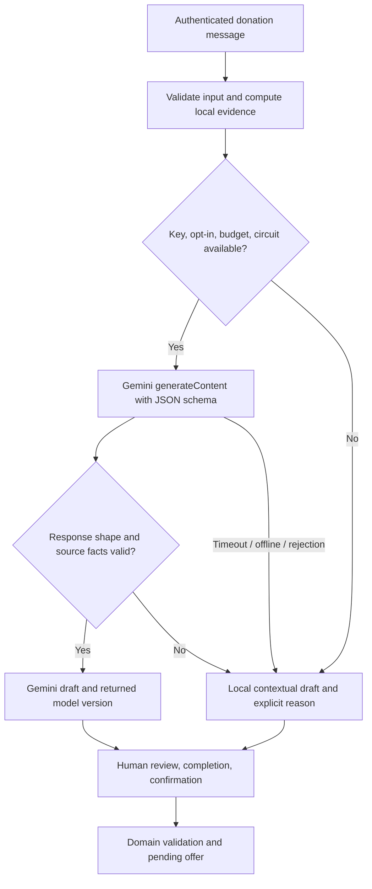

# Gemini with explicit local fallback

Both paths produce an unapproved donation draft. Authorised users review missing fields, confirm donor declarations, and submit through the existing validated workflow. Model output has no access to tools, approvals, reservations, accounts, or delivery transitions.



## Contract and provenance

The six fields are `name`, `food`, `meals`, `deadline`, `handling`, and `allergens`. Unknown values are null, including undeclared allergens. Empty allergens means an explicit declaration of none. The server checks exact keys, value types, bounds, allowed categories, and evidence. Name and food must occur literally in the message; non-null quantities, times, handling, and allergens must match the contextual rules. Unsupported or contradictory model facts cause local fallback.

The local engine creates a small typed graph of donation facts with relations such as `HAS_PORTIONS`, `COLLECT_BY`, and `DECLARES_ALLERGENS`. Relative deadlines can use the supplied simulation clock, with this derivation disclosed. This is deterministic extraction over supported language, not general semantic understanding or a broad world-knowledge graph. Conservative grounding can reject a valid Gemini interpretation outside that vocabulary.

The UI shows source, requested/reported model, completeness, questions, warnings, and expandable source facts. Native progress feedback covers actual request time. No fabricated token stream, deliberation, or hidden chain of thought is displayed.

## Failure containment

- No key: no provider request; use the local engine.
- Invalid credentials, unavailable model, rate limit, offline network, malformed or incomplete response, unsupported facts, or timeout: sanitised local fallback with an explicit reason.
- Default provider timeout: 8 seconds, configurable within a maximum of 20 seconds. Abort and a bounded race prevent a stalled provider from blocking indefinitely.
- Provider failure pauses subsequent attempts for 30 seconds. The next eligible request can retry; requests during the pause use local rules immediately.
- Public AI is disabled by default. Explicit opt-in enables at most 60 actual attempts per hour per process. This is a demo allowance, not a durable billing limit.
- Input, role, authentication, CSRF, and concurrency errors retain their normal HTTP errors. They do not masquerade as successful extraction.

## Configuration and model lifecycle

```dotenv
GEMINI_API_KEY=
GEMINI_MODEL=gemini-2.5-flash
GEMINI_TIMEOUT_MS=8000
PUBLIC_AI_ENABLED=false
```

Keys are transmitted only in the server-side `x-goog-api-key` header. Google receives the submitted donation message, simulation clock, and extraction instructions. Account passwords, network records, GPS feeds, and the API key are not included in the model prompt.

As checked on 25 November 2026, Google's [Gemini 2.5 Flash documentation](https://aistudio.google.com/docs/models/gemini-2.5-flash) marks it deprecated, available to existing users until 1 December 2026, then redirected to Gemini 3.5 Flash-Lite. RescueRoute preserves the requested default and reports Google's actual `modelVersion`. Choose an available Gemini model through configuration; no code change is needed for the model identifier. Compatibility still requires validation when changing models.

The REST request follows Google's [generateContent reference](https://aistudio.google.com/api-reference/generate-content). Its structured response contract uses `responseMimeType: application/json` and `responseSchema`; Google's [API discovery schema](https://generativelanguage.googleapis.com/$discovery/rest?version=v1beta) documents these fields. A JSON schema constrains shape, not factual accuracy.

## Verification boundary

Provider transport and failure paths have mocked tests; 24 fixed fixtures exercise local extraction. A local smoke request with configured credentials returned model-unavailable and exercised actual fallback. Successful live extraction, semantic quality, and provider latency remain unverified. Domain tests independently check reservations, ownership, quantity conservation, ordering, and receipt confirmation. These controls reduce error exposure; they do not prove a zero-error system.
